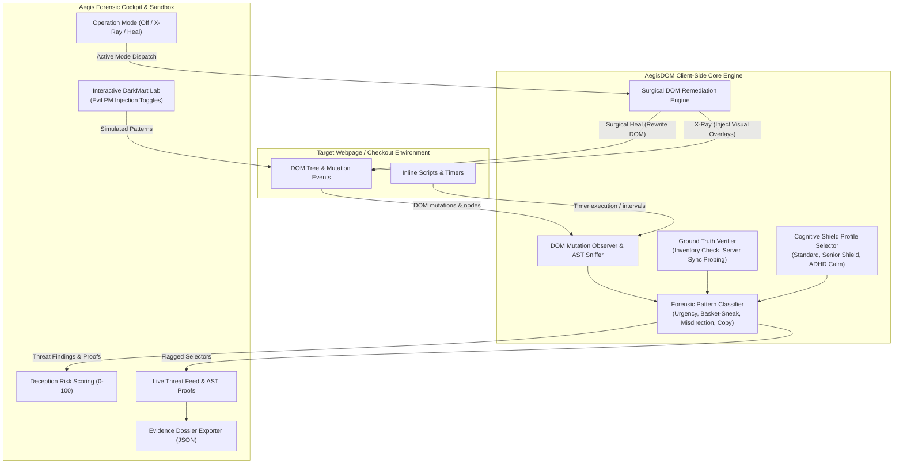
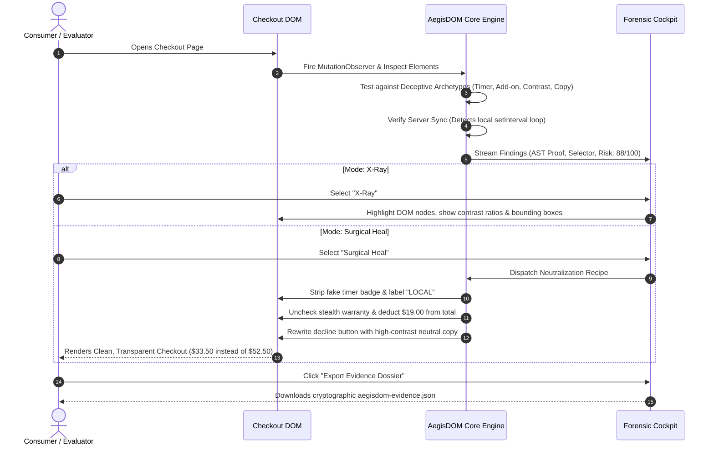

# 🛡️ AegisDOM — Forensic Checkout Protection

> **A real-time forensic cockpit and client-side defense shield for spotting and surgically neutralizing deceptive checkout patterns (dark patterns).**

[](https://nextjs.org/)
[](https://react.dev/)
[](https://www.typescriptlang.org/)
[](https://tailwindcss.com/)
[](LICENSE)
[](https://github.com)

---

## ⚡ The Brief Pitch

### The Problem
Modern e-commerce platforms increasingly deploy **deceptive design patterns ("dark patterns")**—from artificial countdown timers that reset on reload, to pre-selected \$19 warranty checkboxes, confirmshaming decline microcopy, and visually obscured opt-out links. These patterns deliberately exploit human cognitive vulnerabilities, inducing artificial panic, cognitive overload, and accidental checkout add-ons that cost consumers billions annually.

### The Solution: AegisDOM
**AegisDOM** transforms the client's browser into a forensic security cockpit and self-healing interface:
- **Spot the Trick:** Continuously inspects checkout DOM structures and JavaScript mutations in real-time (~38ms latency) to detect deceptive patterns against verifiable ground truth.
- **Explain the Trick (X-Ray Mode):** Provides transparent AST proofs, selectors, and contrast ratio calculations so users understand why a component was flagged.
- **Neutralize the Trick (Surgical Heal):** Programmatically repairs the DOM—strips fake urgency clocks, unchecks stealth add-ons, corrects totals, and transforms manipulative guilt-copy into clear, accessible choices.
- **Zero-Telemetry Privacy:** Operates entirely client-side inside the user's browser environment. No cart data, browsing habits, or personal identifiers ever leave the device.

---

## 🏛️ System Architecture

AegisDOM couples an event-driven DOM surveillance engine with a rule-based forensic classifier and an active client-side mutation pipeline, connected directly to a real-time reactive telemetry cockpit.



---

### Detection & Remediation Sequence



---

## 🔬 Core Architectural Components

### 1. Forensic Detection Modules
* **Synthetic Scarcity Sniffer:** Detects client-side timers generated via `setInterval` or `setTimeout` that reset on browser reload without matching server-sent inventory synchronization (`sync-no`).
* **Basket-Sneak Detector:** Scans for `<input type="checkbox">` elements initialized with `defaultChecked: true` that introduce non-zero recurring costs before user intent has been established.
* **Visual Misdirection Analyzer:** Measures contrast ratios and effective click target dimensions against WCAG 2.1 AA thresholds to detect obscured decline pathways (e.g., contrast `< 1.5:1`, target `< 12px`).
* **Confirmshaming NLP Classifier:** Matches button microcopy against shame-framing lexicons (`"No thanks, I like losing my money"`, `"I prefer paying full price"`).

### 2. Surgical Remediation Engine (DOM Healer)
When operating in **Surgical Heal** mode, AegisDOM executes client-side mutations within **~38ms**:
* Clamps deceptive countdown clocks and replaces them with an *"Artificial urgency removed"* badge.
* Deselects sneaked line items and recalculates subtotal and fee structures.
* Rewrites negative framing copy into clear, neutral alternatives (*"Continue without insurance"*).
* Restores target sizing, focus rings, and contrast on primary navigation buttons.

### 3. Cognitive Shield Profiles
* **Standard:** Balanced protection, unobtrusive badge notifications, and automatic stealth add-on neutralization.
* **Senior Shield:** Enforces enlarged font sizes, 3:1+ high-contrast borders, and strict modal/popup blocking.
* **ADHD Calm:** Dampens visual noise by suppressing pulsing animations, badge counters, and animated banners.

### 4. DarkMart Checkout Sandbox
An embedded interactive e-commerce checkout paired with an **Evil PM Control Panel**, allowing engineers, researchers, and regulators to toggle dark patterns on and off in real time to verify AegisDOM's heuristics and healing algorithms.

---

## 🗂️ Project Structure

```
aegis/
├── app/
│   ├── globals.css              # Custom styling, dark palette tokens & responsive rules
│   ├── layout.tsx               # Root layout, metadata & analytics integration
│   └── page.tsx                 # Application entry point rendering AegisDashboard
├── components/
│   ├── aegis-dashboard.tsx      # Main forensic cockpit, state logic & DarkMart sandbox
│   └── ui/
│       └── button.tsx           # Base-UI accessible button primitive with CVA variants
├── lib/
│   └── utils.ts                 # Classname merge utility (clsx + tailwind-merge)
├── public/                      # Icons, logos, and vector assets
├── next.config.mjs              # Next.js configuration
├── package.json                 # Dependencies and workspace scripts
├── tsconfig.json                # TypeScript compiler configuration
└── README.md                    # Project documentation & architecture overview
```

---

## 🚀 Getting Started

### Prerequisites
- **Node.js**: v18.17+ or v20+ recommended
- **pnpm**: v9+ (or `npm` / `yarn`)

### Installation & Run

1. Clone the repository and navigate to the project directory:
   ```bash
   git clone <repo-url>
   cd dom/aegis
   ```

2. Install dependencies:
   ```bash
   pnpm install
   ```

3. Start the local development server:
   ```bash
   pnpm dev
   ```

4. Open your browser and navigate to:
   ```
   http://localhost:3000
   ```

---

## 🛠️ Tech Stack

| Layer | Technologies |
| :--- | :--- |
| **Framework** | [Next.js](https://nextjs.org/) (App Router, React 19) |
| **Language** | [TypeScript](https://www.typescriptlang.org/) (Strict type checking) |
| **Styling** | [Tailwind CSS v4](https://tailwindcss.com/) & Custom High-Density Cyber-Forensic Theme |
| **Primitives** | [@base-ui/react](https://base-ui.com/) & [Lucide Icons](https://lucide.dev/) |
| **Auditing & Export** | Client-side `Blob` generator for verifiable JSON evidence dossiers |

---

## 🗺️ Roadmap & Future Vision

- [ ] **Chromium / WebExtensions MV3 Port:** Package the AegisDOM engine as a Chrome/Firefox extension with content script injection.
- [ ] **WASM / ONNX Deception Heuristics:** Run lightweight on-device models to detect novel manipulative patterns without cloud latency.
- [ ] **Crowdsourced AST Pattern Registry:** Community-maintained repository of e-commerce trick signatures.
- [ ] **Automated FTC / EU Digital Services Act Reporting:** One-click compliance packet generation for consumer protection regulators.

---

## 📄 License

This project is licensed under the [MIT License](LICENSE).
